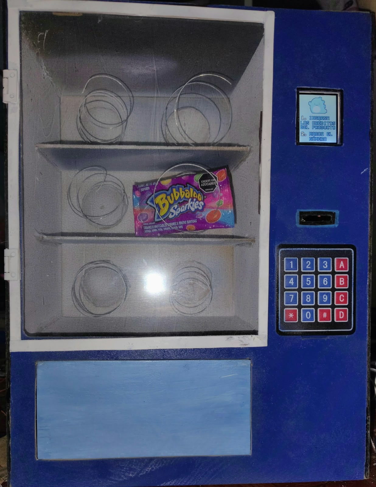

# Mini Máquina Expendedora en FPGA (Terasic DE0)

Implementación en **VHDL** de una mini máquina expendedora de 6 canales sobre la tarjeta **Terasic DE0** (**Intel/Altera Cyclone III EP3C16F484C6**) operando con un reloj maestro de **50 MHz**.

---

## Arquitectura del Sistema

El diseño tiene como entidad superior `maquina_expendedora.vhd` y se divide en los siguientes módulos:

- **`maquina_expendedora` (Top-Level)**: sincronización de entradas físicas con doble flip-flop para evitar metaestabilidad, detección de flancos, lógica de modos de prueba y enrutamiento hacia periféricos.
- **`entrada_ficha`**: acondicionamiento del sensor óptico IR FC-03 (`FICHA_N`). Sincroniza con 2 flip-flops, valida estabilidad durante `0,5 ms`, genera un pulso limpio de 1 ciclo (`saldo + 1`) y bloquea la lectura durante `300 ms` hasta que la ficha salga.
- **`teclado_4x4`**: escaneo de teclado matricial de membrana de 16 teclas. Activa una fila cada `1 ms`, lee las 4 columnas con pull-up interno, valida tras `5` barridos iguales y entrega el código de tecla en `4 bits`.
- **`fsm_expendedora`**: unidad de control de **9 estados** (`REPOSO`, `MANTENIMIENTO`, `VERIFICAR`, `SIN_SALDO`, `AGOTADO`, `DISPENSAR`, `GIRANDO`, `GRACIAS`, `SOBRA`) y ruta de datos:
  - **Saldo (`0–15`)**: sumador de `+ 1` por cada ficha válida.
  - **Precios**: constantes definidas en paquete por espiral (`1, 1, 2, 2, 3, 3`).
  - **Inventario (`6 × 5`)**: un registro por cada espiral; decrementa en `1` por venta y se recarga en modo mantenimiento.
  - **Comparador y restador (`≥ / −`)**: verifica `saldo ≥ precio` y calcula `saldo − precio`.
  - **Total vendido (`0–255`)**: acumulador de créditos vendidos visualizable en mantenimiento.
  - **Temporizador (`28 bits`)**: genera retardos de `2 s` para mensajes y `5 s` de espera.
- **`motor_paso` (×6)**: instanciado mediante `for-generate` (`k = 1..6`). Controla 6 motores paso a paso **28BYJ-48** con drivers **ULN2003** usando secuencia de 4 fases a paso completo (`2048` pasos = 1 vuelta de espiral, `3 ms` por paso ≈ `6 s` por vuelta). En reposo apaga las 4 bobinas para evitar calentamiento.
- **`escenas` y `tft_ili9225`**: controlador **SPI** escrito desde cero para pantalla TFT 2,2" **ILI9225** (`176×220` píxeles):
  - Inicialización mediante `49` comandos de arranque almacenados en ROM.
  - `9` imágenes base de `88×110` a `4 bits` en memoria **M9K**, conversión por paleta **RGB565** y escalado `×2` (`38 720` píxeles por cuadro).
  - Fijación de `1` escena al inicio de cada cuadro para evitar mezcla de imágenes y transmisión SPI a `6,25 MHz` (palabras de `16 bits`).
- **`deco7seg` (×4)**: decodificadores binarios a 7 segmentos para los displays `HEX3–HEX0`.

---

## Hardware y Pinout Principal

| Periférico / Interfaz | Pines / Conector DE0 | Descripción |
| :--- | :--- | :--- |
| Reloj maestro (`CLOCK_50`) | `PIN_G21` | Oscilador de 50 MHz |
| Reset (`BUTTON0`) | `BUTTON[0]` | Reset síncrono general (activo en bajo) |
| Prueba motor (`BUTTON1`) | `BUTTON[1]` | Gira 1 vuelta el motor elegido en `SW3..SW1` |
| Mantenimiento (`SW0`) | `SW[0]` | `1`: recarga inventario y muestra `total` en `HEX2..HEX0` |
| Selección prueba motor | `SW[3:1]` | `001` (motor 1) a `110` (motor 6) |
| Prueba teclado (`SW9`) | `SW[9]` | Muestra última tecla en `HEX0` y columnas activas en `LEDG3..0` |
| Sensor IR ficha (`FICHA_N`) | `GPIO_0` (`J4.13`) | Detector de ficha en ranura |
| Teclado 4×4 (`KP_FILA`, `KP_COL`) | `GPIO_0` (`J4.2–J4.10`) | 4 filas de salida, 4 columnas de entrada |
| Pantalla TFT ILI9225 (SPI) | `GPIO_0` (`J4.14–J4.18`) | `TFT_CS`, `TFT_RS`, `TFT_RST`, `TFT_SCK`, `TFT_SDI` |
| Motores 1 a 6 (`MOTOR1..6`) | `GPIO_1` (`J5`) | 4 fases (`IN1..IN4`) por cada ULN2003 |
| LEDs de estado | `LEDG[9:0]` | `LEDG5..0`: motor girando · `LEDG7`: TFT lista · `LEDG8`: prueba teclado · `LEDG9`: ficha detectada |

> **Nota de alimentación**: La Terasic DE0 se alimenta y programa vía USB-Blaster (`JTAG` `.sof` / Flash `EPCS4` `.jic`), mientras que los 6 drivers ULN2003 y la pantalla TFT se alimentan externamente con un adaptador de **5 V · 2 A** compartiendo tierra común (`GND`).

---

## Simulación, Síntesis y Resultados

- **Simulación (ModelSim)**:
  - `tb_entrada_ficha`: validación de filtrado antirrebote y pulso único por ficha.
  - `tb_fsm_expendedora`: verificación de ciclos completos de compra, saldo insuficiente, producto agotado y mantenimiento.
  - `tb_tft`: verificación de tramas SPI y correspondencia cuadro a cuadro.
- **Síntesis (Quartus II 13.1)**:
  - **Elementos lógicos**: `1 641` de `15 408` (**11 %**).
  - **Memoria integrada (M9K)**: **69 %** (principalmente imágenes y fuentes de la TFT).
  - **Temporización**: Tiempos cumplidos a **50 MHz**.
  - **Arranque autónomo**: Programado en memoria flash serial **EPCS4**.
